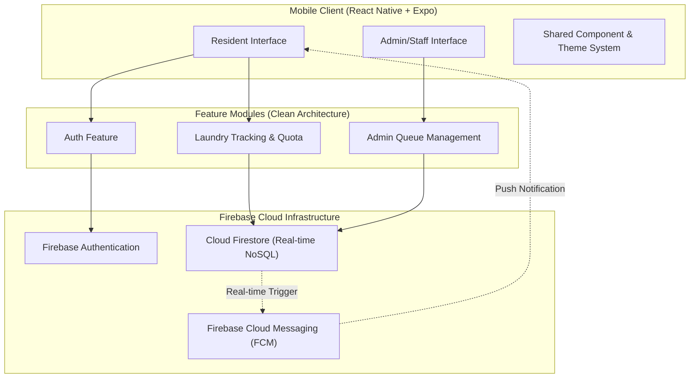
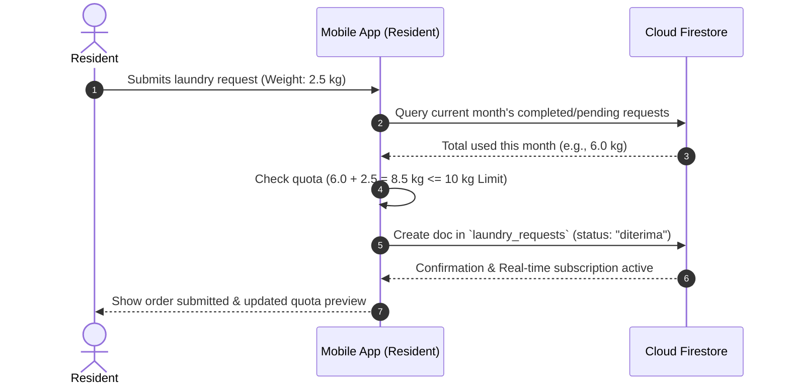
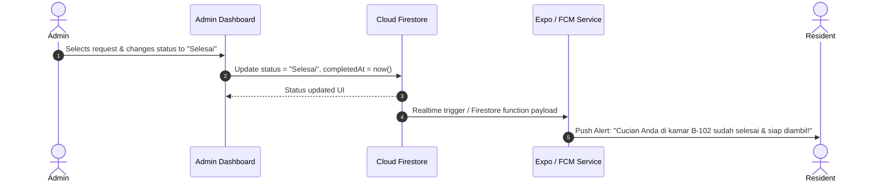

# 🏗️ System Architecture: LaundryAlert

This document outlines the system architecture, technology stack, directory structure, data models, and component interactions for **LaundryAlert** — a mobile application built for boarding house (kos) residents and laundry administrators.

---

## 🎯 Architectural Overview

LaundryAlert is built as a cross-platform mobile application utilizing **React Native with Expo (TypeScript)** on the frontend and **Google Firebase** for backend services (Authentication, Database, Cloud Messaging).



---

## 🛠️ Technology Stack

| Layer | Technology | Rationale |
|---|---|---|
| **Mobile Framework** | React Native + Expo (TypeScript) | Cross-platform (iOS/Android), fast iteration, type safety, simplified push notifications via Expo |
| **Authentication** | Firebase Auth | Built-in email/password authentication and role token management |
| **Database** | Cloud Firestore | Real-time listeners (`onSnapshot`) for instant status updates without polling |
| **Push Notifications** | Expo Notifications + FCM | Timely alerts sent directly to residents when laundry status changes to "Selesai" |
| **State Management** | React Context / Zustand + React Query | Modular state management with cached server state sync |
| **Styling** | React Native StyleSheet / Restyle | Dynamic light/dark theme support with clean separation of presentation styles |

---

## 🧱 Architecture Pattern: Feature-First Clean Architecture

The codebase follows a **Feature-First Clean Architecture** structure. Code is modularized by business feature rather than technical layer. Within each feature folder, clear boundaries are maintained across `presentation`, `domain`, and `data`.

```
LaundryAlert/
├── assets/                  # App icons, splash screens, fonts
├── src/
│   ├── config/              # App & Firebase configuration
│   │   ├── firebase.ts      # Firebase app initialization
│   │   └── constants.ts     # App constants (Default quota: 10kg, etc.)
│   ├── features/
│   │   ├── auth/            # Authentication Feature
│   │   │   ├── data/        # Auth repository & Firebase Auth calls
│   │   │   ├── domain/      # User model, UserRole types
│   │   │   ├── hooks/       # useAuth, useSession hooks
│   │   │   └── presentation/# Login & Register screens, components
│   │   ├── laundry/         # Resident Laundry & Quota Feature
│   │   │   ├── data/        # Laundry Firestore queries & quota calculations
│   │   │   ├── domain/      # LaundryOrder, LaundryStatus, QuotaInfo models
│   │   │   ├── hooks/       # useLaundryOrders, useQuotaTracker hooks
│   │   │   └── presentation/# Submit order, Order history, Quota Card
│   │   └── admin/           # Admin/Staff Queue & Status Management
│   │       ├── data/        # Status updater & queue queries
│   │       ├── domain/      # AdminQueueFilter models
│   │       ├── hooks/       # useAdminQueue, useUpdateLaundryStatus
│   │       └── presentation/# Admin Dashboard, Status update modal
│   ├── shared/              # Cross-cutting concerns & shared UI
│   │   ├── components/      # Button, Card, Badge, Input, Modal, Loader
│   │   ├── theme/           # Color palette, Typography, Spacing
│   │   ├── utils/           # Date formatters, Validators, Error handlers
│   │   └── notifications/   # Push notification helpers & permissions
│   └── navigation/          # React Navigation setup
│       ├── RootNavigator.tsx
│       ├── AuthNavigator.tsx
│       ├── ResidentTabNavigator.tsx
│       └── AdminTabNavigator.tsx
├── architecture.md          # System Architecture Documentation
├── README.md                # Project Overview & Requirements
└── package.json
```

---

## 📊 Data Schema Design (Cloud Firestore)

### 1. `users` Collection
Stores user profiles and quota allocation settings.

```typescript
interface UserDocument {
  uid: string;                 // Firebase Auth UID
  name: string;                // Full name
  email: string;               // Email address
  roomNumber: string;          // Room/Kos number (e.g. "B-102")
  role: 'resident' | 'admin';  // User role
  monthlyQuotaKg: number;      // Monthly allotment (default: 10)
  pushToken?: string;          // Expo Push Token for FCM
  createdAt: FirebaseFirestore.Timestamp;
}
```

### 2. `laundry_requests` Collection
Stores individual laundry drop-offs and their life-cycle status.

```typescript
type LaundryStatus = 'diterima' | 'diproses' | 'selesai' | 'diambil';

interface LaundryRequestDocument {
  id: string;                  // Request UUID
  userId: string;              // Reference to User UID
  userName: string;            // Cached resident name for quick display
  roomNumber: string;          // Cached room number
  estimatedWeightKg: number;   // Weight entered by resident (in kg)
  actualWeightKg?: number;     // Verified weight entered by staff
  status: LaundryStatus;       // Current processing status
  notes?: string;              // Optional notes (e.g., "Special care for jacket")
  submittedAt: FirebaseFirestore.Timestamp;
  updatedAt: FirebaseFirestore.Timestamp;
  completedAt?: FirebaseFirestore.Timestamp;
  pickedUpAt?: FirebaseFirestore.Timestamp;
}
```

---

## 🔄 Core Flow & Data Processing

### A. Laundry Submission & Quota Calculation Flow


### B. Status Update & Notification Trigger Flow


---

## 🔐 Security & Access Control

1. **Role-Based Navigation**:
   - Residents only access Resident Screens (New Request, Quota Tracker, Order History).
   - Admins only access Admin Screens (Order Queue, Status Changer, Resident List).

2. **Firestore Security Rules**:
   - **Residents**: Read and write only their own requests (`request.auth.uid == resource.data.userId`).
   - **Admins**: Read and write access to all requests across all residents.

---

## 🚀 Development & Implementation Roadmap

| Milestone | Deliverables |
|---|---|
| **Phase 1: Foundation** | Project setup (React Native Expo + TypeScript), Firebase Auth integration, Shared UI Theme |
| **Phase 2: Resident Core** | Request Submission form, Real-time status tracker screen, Monthly quota calculation engine |
| **Phase 3: Admin Core** | Admin queue view, Filter by status, One-tap status update modal |
| **Phase 4: Notifications & Polish** | Expo push notifications integration on status change, Order history, Final end-to-end testing |

---
