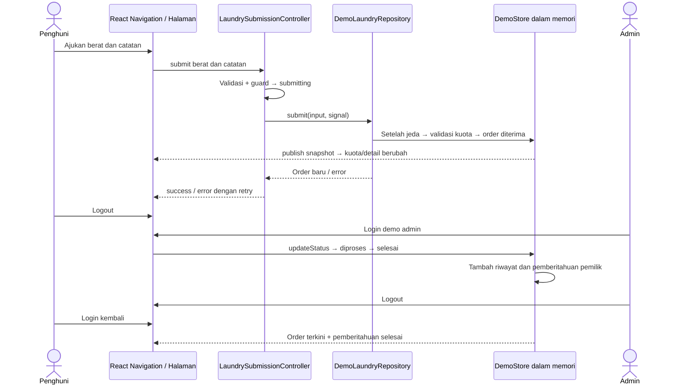
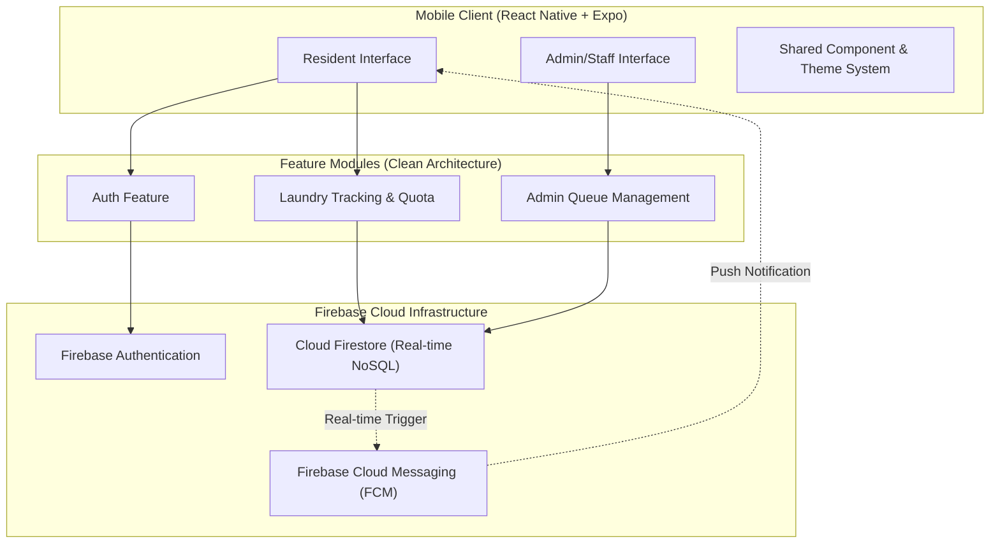
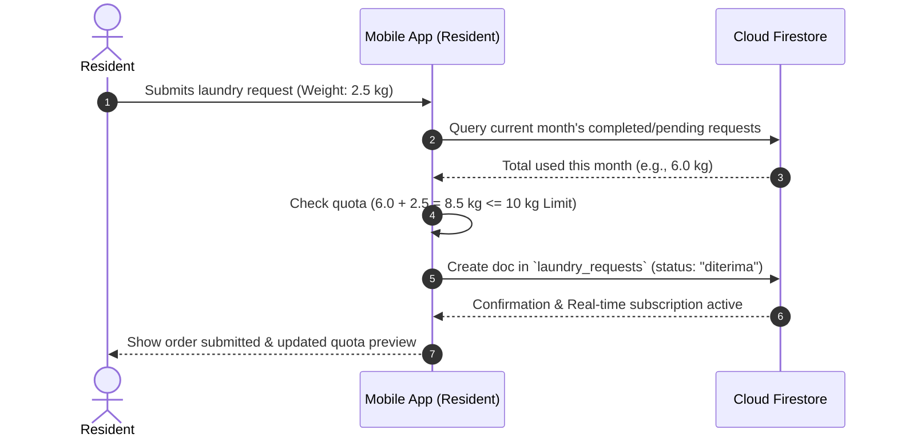
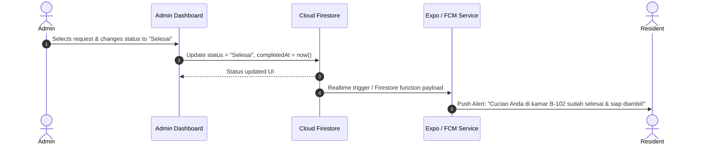

# Arsitektur LaundryAlert — Implementasi Prototype

## Status saat ini

Prototype memakai **Expo SDK 57 + React Native + TypeScript strict**, **React Navigation 7**, React Context, dan React Native StyleSheet. Tidak memakai Expo Router, Firebase SDK, React Query, Zustand, atau layanan push.

| Kategori | Yang tersedia |
|---|---|
| Sudah dibuat | Delapan halaman, routing berdasarkan sesi/peran, form dengan enam kondisi UI, controller/notifier, repository asinkron, komponen reusable, tema, filter antrean, detail/timeline, tes logika dan komponen |
| Disimulasikan | Credential akun, registrasi sementara, order dan kuota dalam memori, pembaruan status langsung pada satu proses, pemberitahuan selesai dalam dashboard |
| Direncanakan | Firebase Authentication, Firestore/onSnapshot, aturan akses backend, timestamp Firestore, Expo/FCM untuk push/background |

## Struktur nyata

```text
LaundryAlert/
├── App.tsx                       # Provider + navigator
├── index.ts                      # registerRootComponent Expo
├── app.json
├── package.json / package-lock.json / tsconfig.json
├── assets/                       # Aset bawaan template Expo
├── docs/prototype-demo.jpg        # Bukti tampilan browser dari skenario demo
├── docs/state-management/         # Screenshot enam kondisi fitur pengajuan
├── jest.config.js                 # Jest Expo + tes komponen RN
├── src/
│   ├── config/constants.ts        # Kuota, timezone, akun demo
│   ├── features/
│   │   ├── auth/
│   │   │   ├── domain/models.ts
│   │   │   ├── data/authService.ts
│   │   │   ├── hooks/useAuth.ts
│   │   │   └── presentation/     # LoginScreen, RegisterScreen
│   │   ├── laundry/
│   │   │   ├── domain/           # models.ts, rules.ts, laundryRepository.ts
│   │   │   ├── data/             # demoStore.ts, seed.ts, demoLaundryRepository.ts
│   │   │   ├── state/            # LaundrySubmissionController.ts
│   │   │   ├── hooks/            # useLaundry.ts, useLaundrySubmission.ts
│   │   │   └── presentation/     # Dashboard, SubmitLaundryScreen/View, Detail, History
│   │   └── admin/
│   │       ├── domain/models.ts  # AdminQueueFilter
│   │       ├── hooks/useAdminQueue.ts
│   │       └── presentation/    # AdminDashboard, AdminDetail
│   ├── shared/
│   │   ├── components/          # Button, Input, LaundryCard, StatusBadge,
│   │   │                        # QuotaCard, EmptyState, Screen, OrderDetails
│   │   ├── theme/theme.ts
│   │   ├── state/DemoProvider.tsx
│   │   └── utils/format.ts
│   └── navigation/              # Root, Auth, Resident, Admin navigator,
│                                # LogoutButton, types.ts
└── tests/                        # demoStore.test.ts, laundryRepository.test.ts,
                                 # ui/laundrySubmission.test.tsx
```

Admin memakai layanan laundry yang sama melalui hooks; tidak memiliki repository atau salinan order sendiri. Folder `data/` admin tidak dibuat karena tidak ada sumber data admin yang terpisah. Tidak ada `firebase.ts` atau folder notifikasi kosong.

## Routing dan halaman

`SafeAreaProvider → DemoProvider → NavigationContainer → navigator sesuai sesi`. DemoProvider memiliki satu DemoStore selama aplikasi berjalan. Logout menghapus pengguna aktif, mempertahankan order, akun, dan pemberitahuan.

| Navigator | Route | Halaman / parameter |
|---|---|---|
| Auth native stack | `Login`, `Register` | Login dan registrasi |
| Resident native stack | `ResidentTabs` | Bottom tabs `Dashboard` (Beranda), `History` (Riwayat) |
| Resident native stack | `SubmitLaundry` | Form pengajuan |
| Resident native stack | `LaundryDetail` | Detail, `{ orderId: string }` |
| Admin native stack | `AdminDashboard` | Antrean/filter |
| Admin native stack | `AdminDetail` | Detail/tindakan status, `{ orderId: string }` |

Root merender satu navigator sesuai pengguna/peran. Perubahan sesi melepas navigator sebelumnya, sehingga tombol kembali tidak membuka halaman sesi lama. Detail menerima ID, bukan salinan order; perubahan dibaca ulang dari store. Sesudah pengajuan sukses, konfirmasi tetap terlihat dan form terkunci. Tombol Lihat detail laundry mengganti route form dengan detail; Buat pengajuan lagi melakukan reset secara eksplisit. Logout tersedia pada header halaman utama.

## Model dan antarmuka layanan

- `User`: `id`, `name`, `email`, `roomNumber`, `role`, `monthlyQuotaKg`, `createdAt`.
- `RegistrationInput`: nama, email, kamar, kata sandi, dan konfirmasi. Registrasi selalu menghasilkan penghuni.
- `LaundryOrder`: `id`, `userId`, `userName`, `roomNumber`, `estimatedWeightKg`, `notes`, `status`, `submittedAt`, `updatedAt`, `statusHistory`, opsional `completedAt`/`pickedUpAt`.
- `LaundryStatus`: `diterima | diproses | selesai | diambil`. `statusHistory` berupa daftar `{ status, at }`.
- `QuotaInfo`: `month` (`YYYY-MM` WIB), `limitKg`, `usedKg`, `remainingKg`.
- `CompletionNotice`: `id`, `orderId`, `userId`, `createdAt`; pemberitahuan dihapus hanya ketika pemilik menutupnya.
- `AdminQueueFilter`: `semua | LaundryStatus`.

Semua timestamp berupa ISO string pada prototype. DemoAccount menyimpan pasangan profil dan kata sandi simulasi secara privat dalam DemoStore, terpisah dari snapshot UI. Tidak ada berat aktual atau push token dalam model prototype karena belum dipakai.

DemoStore menyediakan `login`, `register`, `logout`, `visibleOrders`, `quota`, `submit`, `updateStatus`, dan `dismissNotice`. `getSnapshot`/`subscribe` menghubungkan perubahan store ke React melalui `useSyncExternalStore` di context. Pembaruan sinkron membuat validasi kuota dan penambahan order berjalan dalam satu tindakan. `createSeed(clock)` dan injeksi clock memungkinkan tes pergantian bulan tanpa mengubah jam komputer.

### Aturan domain

Berat menerima koma/titik hingga dua desimal dan harus positif. Kuota 10 kg menggunakan jumlah perseratus kilogram dari seluruh pengajuan pemilik pada bulan pengajuan WIB; semua status dihitung. Pengajuan melewati sisa kuota ditolak, tepat batas diterima. Tanggal antar diisi saat submit. Status hanya maju satu tahap dan hanya admin dapat mengubahnya.

Seed dibuat relatif bulan saat aplikasi dimulai: Alya memiliki 2 kg diterima, 1,5 kg selesai bulan ini, dan 4 kg sudah diambil bulan sebelumnya. Bima memiliki 3 kg diproses bulan ini. Seed selesai memuat pemberitahuan contoh. Penghuni baru memulai dengan kuota utuh dan daftar kosong.

### Pemisahan fitur Pengajuan Laundry

State management tetap memakai React Context untuk menyediakan satu DemoStore dan `useSyncExternalStore` untuk snapshot reaktif. Controller fitur menjadi notifier/use case bagi state form dan request; tidak ada framework state kedua. Riverpod tidak dipasang karena proyek memakai React Native, bukan Flutter.

| Lapisan | Tanggung jawab |
|---|---|
| `SubmitLaundryScreen` / `useLaundrySubmission` | Membuat repository/controller untuk sesi saat ini, menghubungkan subscription, cleanup saat unmount, dan routing detail |
| `SubmitLaundryView` | Render berdasarkan state, meneruskan event input/tombol, menampilkan pesan, spinner, empty state, dan retry; tidak menyimpan data atau menghitung kuota |
| `LaundrySubmissionController` | Snapshot immutable, load/retry, state form, validasi domain, guard submit sebelum await, transisi sukses/error, reset dan pembatalan |
| `LaundryRepository` | Kontrak `load(signal)`, `submit(input, signal)`, `subscribe(listener)`; mengembalikan order dan kuota penghuni |
| `DemoLaundryRepository` | Implementasi asinkron dengan jeda 1,5 detik, kegagalan sekali untuk demo, pembatasan sesi, baca/tulis/subscription DemoStore |
| `rules.ts` / `DemoStore` | Aturan berat/kuota/status dan penyimpanan bersama; validasi kuota terakhir dan penulisan order sinkron dalam satu operasi |

`SubmissionState` memisahkan `loadStatus: loading | loaded | error` dari `submitStatus: idle | submitting | success | error`, beserta data, input, pesan validasi, pesan layanan, dan order yang berhasil dikirim. Empty state diturunkan dari `orders.length === 0` setelah load berhasil. Input tidak valid berhenti sebelum request. UI disabled serta guard controller mencegah double tap, termasuk dua pemanggilan sebelum render berikutnya. Success juga dikunci hingga reset eksplisit agar request yang sudah berhasil tidak terkirim ulang.

Setiap load membatalkan request sebelumnya dan memeriksa versi respons. Unmount membatalkan load/submit dengan AbortController; respons yang terlambat tidak memperbarui state. Repository memeriksa identitas sesi sebelum dan setelah jeda serta memvalidasi kuota kembali pada saat commit. Kegagalan submit tidak mengurangi kuota dan mempertahankan input untuk retry. Subscription memakai sumber data yang sama dengan admin dan dashboard; logout hanya menghapus sesi, bukan order.

Panel development mengatur satu kegagalan repository, kemudian menjalankan use case biasa. Error/retry benar-benar melewati Promise reject dan request berikutnya. Jeda dan error disimulasikan; tidak tersedia koneksi Firebase pada implementasi ini.

### Alur data prototype



Perangkat berbeda tidak tersinkron. Pemberitahuan bukan push dan tidak berjalan saat aplikasi ditutup. Restart/reload penuh mengembalikan seed. Pergantian bulan diperiksa ketika hook/operasi menghitung kuota kembali, tanpa timer latar belakang.

## Komponen dan verifikasi

Theme mengatur warna, typography, spacing dan radius. Button, Input, LaundryCard, StatusBadge, QuotaCard dan EmptyState dipakai pada halaman relevan; Screen menangani scrolling, safe area serta keyboard. OrderDetails berbagi ringkasan/timeline antara admin dan penghuni. Tampilan memakai bahasa Indonesia, tema terang, dan tombol minimal 44–48 px.

Pemeriksaan: TypeScript, 19 tes domain/store/repository dengan Node test runner + tsx, 13 tes komponen dengan Jest Expo + React Native Testing Library, `expo install --check`, Expo Doctor, dan ekspor Android/iOS/web. Tes komponen merupakan padanan widget test pada React Native: render view nyata, ubah input, tekan tombol, dan periksa spinner/pesan/disabled serta jumlah request. Promise terkontrol menjaga pemeriksaan state pending tetap deterministik. Tes meliputi keenam kondisi wajib, retry, enam kasus validasi, guard double tap, sukses/reset/detail, dan gagal submit dengan input tetap tersedia. Tes repository nyata meliputi subscription kuota, pembatalan, sesi berubah, dan kuota yang berubah selama request.

Seluruh 32 tes lulus. Enam screenshot browser ada di `docs/state-management/` dan ditampilkan beserta panduan reproduksi pada README. Pengujian browser tambahan memeriksa pemulihan retry, kuota setelah submit, dan akun baru tanpa order. HP/emulator belum diuji; ekspor bundle bukan pengganti uji perangkat.

## Tahap integrasi Firebase

Ganti credential `authService`/operasi sesi dengan Firebase Authentication; implementasikan kontrak `LaundryRepository` dengan Firestore dan subscription `onSnapshot` untuk form. Controller dan view dapat tetap dipakai. Dashboard/admin dan operasi status juga perlu dimigrasikan dari DemoStore ke sumber backend yang sama; mengganti repository form saja belum memigrasikan seluruh aplikasi. Timestamp ISO dipetakan dari/ke Firestore Timestamp. Validasi kuota harus dipindahkan ke transaksi/layanan backend agar aman terhadap pengajuan serentak. Simulasi jeda/kegagalan development dihapus pada repository produksi.

Role admin ditetapkan oleh pengelola/backend, bukan pilihan saat registrasi. Firestore Security Rules membatasi data penghuni menurut UID dan perubahan status menurut role; validasi pada UI tidak cukup. Notifikasi produksi memerlukan token perangkat, layanan pengirim tepercaya, konfigurasi Expo/FCM, dan deduplikasi event selesai.

Rancangan Firebase awal di bawah dipertahankan sebagai referensi masa depan. Struktur folder, daftar komponen dan roadmap pada bagian tersebut **bukan implementasi prototype saat ini**. Resident List, tema gelap, berat aktual, dan React Query belum dibuat.

---

# Rancangan Backend Awal — Referensi Integrasi Firebase

This document outlines the system architecture, technology stack, directory structure, data models, and component interactions for **LaundryAlert** — a mobile application built for boarding house (kos) residents and laundry administrators.

---

## 🎯 Architectural Overview

The planned production LaundryAlert architecture uses **React Native with Expo (TypeScript)** on the frontend and **Google Firebase** for backend services (Authentication, Database, Cloud Messaging). The current prototype uses the in-memory implementation documented above.



---

## 🛠️ Technology Stack

| Layer | Technology | Rationale |
|---|---|---|
| **Mobile Framework** | React Native + Expo (TypeScript) | Cross-platform (iOS/Android), fast iteration, type safety, simplified push notifications via Expo |
| **Authentication** | Firebase Auth | Built-in email/password authentication and role token management |
| **Database** | Cloud Firestore | Real-time listeners (`onSnapshot`) for instant status updates without polling |
| **Push Notifications** | Expo Notifications + FCM | Timely alerts sent directly to residents when laundry status changes to "Selesai" |
| **State Management** | React Context / Zustand + React Query | Modular state management with cached server state sync |
| **Styling** | React Native StyleSheet / Restyle | Dynamic light/dark theme support with clean separation of presentation styles |

---

## 🧱 Architecture Pattern: Feature-First Clean Architecture

The codebase follows a **Feature-First Clean Architecture** structure. Code is modularized by business feature rather than technical layer. Within each feature folder, clear boundaries are maintained across `presentation`, `domain`, and `data`.

```
LaundryAlert/
├── assets/                  # App icons, splash screens, fonts
├── src/
│   ├── config/              # App & Firebase configuration
│   │   ├── firebase.ts      # Firebase app initialization
│   │   └── constants.ts     # App constants (Default quota: 10kg, etc.)
│   ├── features/
│   │   ├── auth/            # Authentication Feature
│   │   │   ├── data/        # Auth repository & Firebase Auth calls
│   │   │   ├── domain/      # User model, UserRole types
│   │   │   ├── hooks/       # useAuth, useSession hooks
│   │   │   └── presentation/# Login & Register screens, components
│   │   ├── laundry/         # Resident Laundry & Quota Feature
│   │   │   ├── data/        # Laundry Firestore queries & quota calculations
│   │   │   ├── domain/      # LaundryOrder, LaundryStatus, QuotaInfo models
│   │   │   ├── hooks/       # useLaundryOrders, useQuotaTracker hooks
│   │   │   └── presentation/# Submit order, Order history, Quota Card
│   │   └── admin/           # Admin/Staff Queue & Status Management
│   │       ├── data/        # Status updater & queue queries
│   │       ├── domain/      # AdminQueueFilter models
│   │       ├── hooks/       # useAdminQueue, useUpdateLaundryStatus
│   │       └── presentation/# Admin Dashboard, Status update modal
│   ├── shared/              # Cross-cutting concerns & shared UI
│   │   ├── components/      # Button, Card, Badge, Input, Modal, Loader
│   │   ├── theme/           # Color palette, Typography, Spacing
│   │   ├── utils/           # Date formatters, Validators, Error handlers
│   │   └── notifications/   # Push notification helpers & permissions
│   └── navigation/          # React Navigation setup
│       ├── RootNavigator.tsx
│       ├── AuthNavigator.tsx
│       ├── ResidentTabNavigator.tsx
│       └── AdminTabNavigator.tsx
├── architecture.md          # System Architecture Documentation
├── README.md                # Project Overview & Requirements
└── package.json
```

---

## 📊 Data Schema Design (Cloud Firestore)

### 1. `users` Collection
Stores user profiles and quota allocation settings.

```typescript
interface UserDocument {
  uid: string;                 // Firebase Auth UID
  name: string;                // Full name
  email: string;               // Email address
  roomNumber: string;          // Room/Kos number (e.g. "B-102")
  role: 'resident' | 'admin';  // User role
  monthlyQuotaKg: number;      // Monthly allotment (default: 10)
  pushToken?: string;          // Expo Push Token for FCM
  createdAt: FirebaseFirestore.Timestamp;
}
```

### 2. `laundry_requests` Collection
Stores individual laundry drop-offs and their life-cycle status.

```typescript
type LaundryStatus = 'diterima' | 'diproses' | 'selesai' | 'diambil';

interface LaundryRequestDocument {
  id: string;                  // Request UUID
  userId: string;              // Reference to User UID
  userName: string;            // Cached resident name for quick display
  roomNumber: string;          // Cached room number
  estimatedWeightKg: number;   // Weight entered by resident (in kg)
  actualWeightKg?: number;     // Verified weight entered by staff
  status: LaundryStatus;       // Current processing status
  notes?: string;              // Optional notes (e.g., "Special care for jacket")
  submittedAt: FirebaseFirestore.Timestamp;
  updatedAt: FirebaseFirestore.Timestamp;
  completedAt?: FirebaseFirestore.Timestamp;
  pickedUpAt?: FirebaseFirestore.Timestamp;
}
```

---

## 🔄 Core Flow & Data Processing

### A. Laundry Submission & Quota Calculation Flow


### B. Status Update & Notification Trigger Flow


---

## 🔐 Security & Access Control

1. **Role-Based Navigation**:
   - Residents only access Resident Screens (New Request, Quota Tracker, Order History).
   - Admins only access Admin Screens (Order Queue, Status Changer, Resident List).

2. **Firestore Security Rules**:
   - **Residents**: Read and write only their own requests (`request.auth.uid == resource.data.userId`).
   - **Admins**: Read and write access to all requests across all residents.

---

## 🚀 Development & Implementation Roadmap

| Milestone | Deliverables |
|---|---|
| **Phase 1: Foundation** | Project setup (React Native Expo + TypeScript), Firebase Auth integration, Shared UI Theme |
| **Phase 2: Resident Core** | Request Submission form, Real-time status tracker screen, Monthly quota calculation engine |
| **Phase 3: Admin Core** | Admin queue view, Filter by status, One-tap status update modal |
| **Phase 4: Notifications & Polish** | Expo push notifications integration on status change, Order history, Final end-to-end testing |

---
