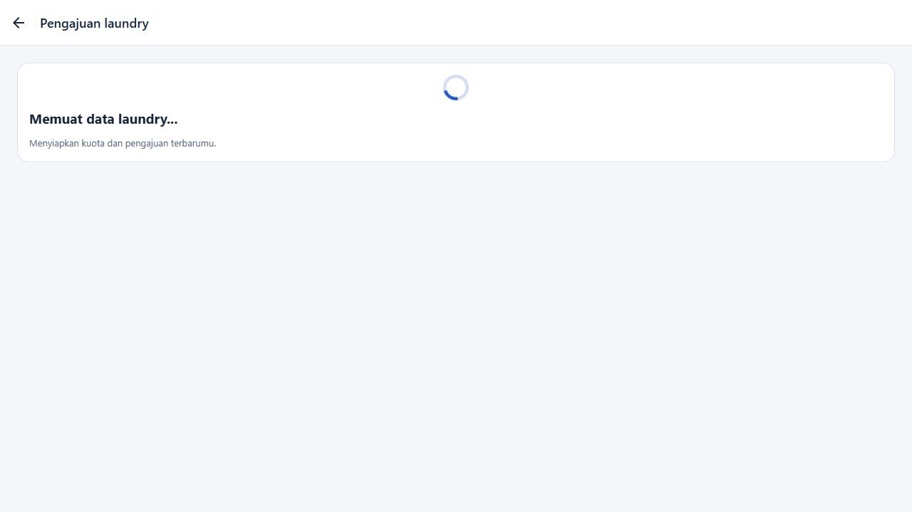
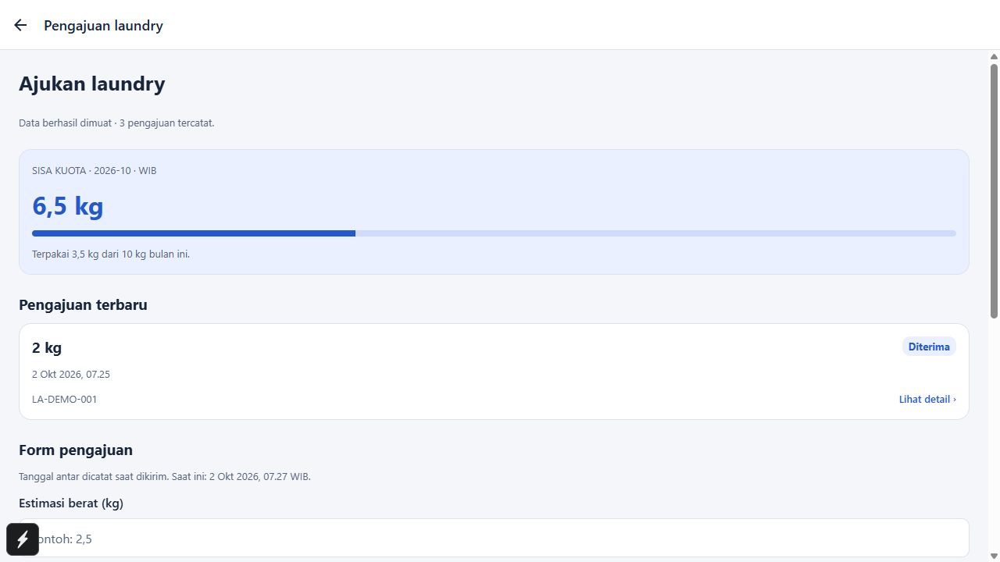
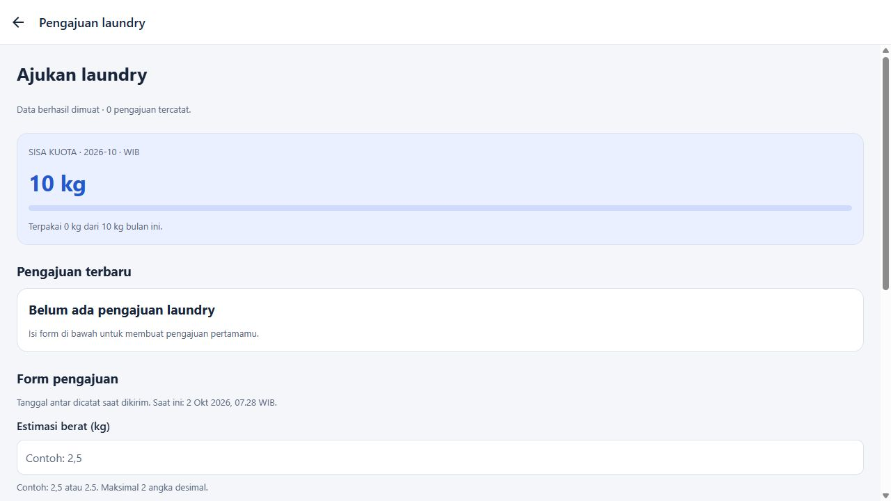
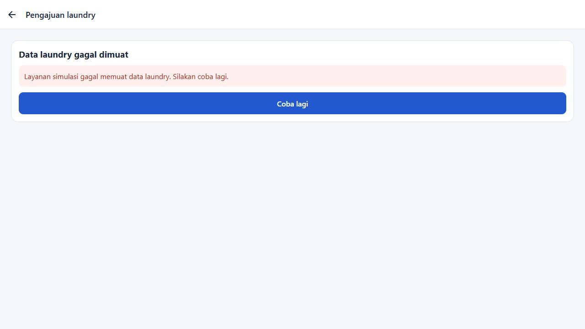
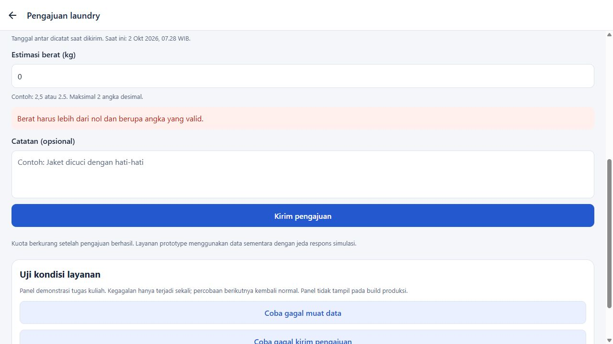
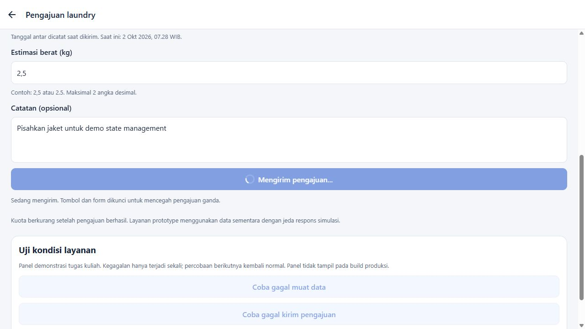
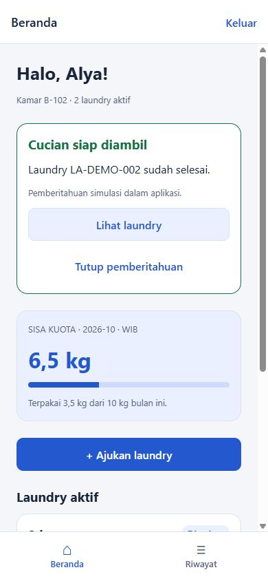

# LaundryAlert — Prototype Mobile

Prototype tugas kuliah dengan **React Native, Expo SDK 57, TypeScript, dan React Navigation**. Delapan halaman tersedia dan memakai satu penyimpanan simulasi dalam memori. Firebase belum dihubungkan.

## Status implementasi

| Status | Fitur |
|---|---|
| Sudah dibuat | Login, registrasi, dashboard penghuni, pengajuan, detail/progres, riwayat, antrean admin/filter, pembaruan status, logout, komponen dan tema bersama |
| Masih disimulasikan | Autentikasi, akun sementara, data laundry bersama dalam satu aplikasi, kuota 10 kg, pemberitahuan saat selesai |
| Tahap integrasi Firebase | Firebase Authentication, Firestore dan sinkronisasi antarperangkat, aturan akses server, notifikasi push melalui Expo/FCM |

## Menjalankan di Windows

### Prasyarat

1. **Node.js LTS 22.13 atau lebih baru**, beserta npm. Proyek diverifikasi dengan Node.js 24.21.0.
2. PowerShell atau terminal VS Code.
3. Untuk cara termudah, pasang **Expo Go** terbaru di HP Android yang kompatibel dengan SDK 57. Tidak diperlukan Android Studio untuk cara ini.
4. Komputer dan HP terhubung ke jaringan Wi-Fi yang sama.

Jalankan dari PowerShell:

```powershell
cd "C:\Users\micha\OneDrive\Dokumen\LaundryAlert"
npm ci
npm start
```

Jika dependensi sudah terpasang, cukup `npm start`. Scan QR yang muncul menggunakan Expo Go di Android. Server perlu tetap berjalan selama mencoba aplikasi. Untuk menghentikannya, tekan `Ctrl+C` di terminal.

Jika QR tidak terhubung, periksa jaringan yang sama dan izin Windows Firewall untuk Node.js pada jaringan privat. Alternatifnya gunakan `npx expo start --tunnel`; Expo mungkin meminta pemasangan pendukung tunnel dan membutuhkan koneksi internet. Jika tampilan Expo Go menyatakan SDK tidak cocok, perbarui Expo Go atau gunakan versi kompatibel dari [halaman Expo Go resmi](https://expo.dev/go).

Jika PowerShell menolak `npm.ps1` karena execution policy, gunakan `npm.cmd ci` dan `npm.cmd start` tanpa mengubah pengaturan keamanan PowerShell.

### Emulator Android

Pasang Android Studio, Android SDK, dan buat perangkat virtual melalui Device Manager. Jalankan emulator terlebih dahulu; pastikan SDK platform-tools tersedia melalui PATH dan `ANDROID_HOME` menunjuk ke folder SDK Android. Lalu jalankan:

```powershell
npm run android
```

Atau tekan `a` pada terminal Expo yang sudah berjalan. Emulator dapat memerlukan waktu untuk memasang atau membuka Expo Go. Simulator iOS lokal membutuhkan macOS; Windows tidak dapat menjalankannya. Proyek juga menyediakan pratinjau browser melalui `npm run web` untuk mencoba UI; hasil browser bukan bukti pengujian di HP.

## Akun demo dan registrasi

Pada Login, pilih **Masuk demo penghuni** atau **Masuk demo admin**. Tombol tersebut mengisi sesi dari akun contoh berikut:

| Peran | Email | Kata sandi |
|---|---|---|
| Penghuni — Alya, B-102 | `penghuni@laundryalert.test` | `demo123` |
| Admin/petugas | `admin@laundryalert.test` | `demo123` |

Data contoh juga memuat Bima (B-103), agar antrean admin menunjukkan beberapa penghuni. Login manual Bima dapat menggunakan `bima@laundryalert.test` / `demo123`.

Registrasi membuat akun **penghuni sementara**, lalu langsung masuk. Isi nama, email valid, nomor kamar, kata sandi minimal enam karakter, dan konfirmasi yang sama. Email harus unik dalam sesi, tanpa membedakan huruf besar/kecil. Akun dapat login lagi setelah logout, sampai aplikasi direstart/reload penuh. Gunakan data serta kata sandi contoh saja; sandi simulasi berada dalam memori dan bukan mekanisme keamanan produksi. Tidak tersedia pendaftaran admin.

## Skenario demo pada satu perangkat

1. Masuk demo penghuni. Dashboard menampilkan 2 laundry aktif dan sisa kuota **6,5 kg** pada seed awal.
2. Tutup pemberitahuan seed jika diperlukan. Tekan **Ajukan laundry** dan tunggu data dimuat. Isi berat `2,5` dan catatan opsional, lalu kirim. Tombol dan form terkunci selama proses. Setelah pesan berhasil, tekan **Lihat detail laundry**. Detail baru berstatus **Diterima**; sisa kuota menjadi **4 kg**.
3. Kembali ke Beranda dan tekan **Keluar**. Masuk demo admin, lalu buka pengajuan terbaru milik Alya. Coba filter Diterima pada antrean.
4. Tekan **Ubah menjadi Diproses**, kemudian **Ubah menjadi Selesai**. Pesan admin mengonfirmasi pembuatan pemberitahuan simulasi.
5. Kembali ke antrean, **Keluar**, lalu masuk demo penghuni lagi. Dashboard memperlihatkan laundry **Selesai**, kuota tetap 4 kg, dan pemberitahuan **Cucian siap diambil**. Buka detail dari pemberitahuan atau kartu laundry.
6. Jika ingin menyelesaikan alur, masuk admin kembali dan ubah ke **Sudah diambil**. Pada penghuni, order keluar dari daftar aktif tetapi tetap ada di Riwayat. Kuota tidak dikembalikan.

Gunakan proses aplikasi yang sama dan jangan reload/restart di antara langkah. Dua HP, dua tab browser, atau dua proses aplikasi memiliki penyimpanan terpisah.

## Fitur tugas: Pengajuan Laundry dengan enam kondisi UI

Fitur ini menggunakan **React Context + external store/controller (`useSyncExternalStore`)** secara konsisten dengan aplikasi React Native yang sudah ada. Riverpod adalah pilihan untuk Flutter; pada proyek ini tes komponen React Native berperan sebagai widget test. State berubah karena operasi repository asinkron, bukan sekadar pergantian tampilan manual.

| Kondisi wajib | Perilaku nyata | Bukti browser |
|---|---|---|
| Initial loading | Spinner saat repository memuat data; form belum dapat dipakai | [01-initial-loading.jpg](./docs/state-management/01-initial-loading.jpg) |
| Data berhasil dimuat | Kuota, pengajuan terbaru, dan form tampil | [02-loaded.jpg](./docs/state-management/02-loaded.jpg) |
| Empty state | Penghuni baru tanpa order melihat pesan kosong dan form aktif | [03-empty.jpg](./docs/state-management/03-empty.jpg) |
| Error + retry | Kegagalan repository menampilkan pesan dan **Coba lagi** yang mengulang request | [04-load-error.jpg](./docs/state-management/04-load-error.jpg) |
| Validasi form | Pesan dekat input; berat tidak valid tidak memanggil repository | [05-validation.jpg](./docs/state-management/05-validation.jpg) |
| Submit loading | Spinner, tombol disabled/busy, input dikunci; guard controller mencegah dua request | [06-submitting.jpg](./docs/state-management/06-submitting.jpg) |

Tambahan: kegagalan submit mempertahankan input dengan **Coba kirim lagi**; keberhasilan memperbarui kuota/order, mengunci pengajuan yang sudah dikirim, dan menyediakan **Lihat detail laundry** serta **Buat pengajuan lagi**. Data tetap tersedia setelah logout. Operasi yang masih menunggu dibatalkan ketika halaman dilepas; sesi dan kuota diperiksa kembali sebelum penyimpanan.

### Cara memperagakan kondisi

1. Jalankan `npm run web`, masuk demo penghuni, lalu **Ajukan laundry**. Jeda layanan 1,5 detik memperlihatkan loading sebelum data berhasil dimuat.
2. Masukkan `0`, kosong, teks, nilai negatif, lebih dari dua desimal, atau lebih dari sisa kuota, lalu **Kirim pengajuan** untuk memperlihatkan validasi. Nilai `2,5` dan `2.5` diterima.
3. Pada panel **Uji kondisi layanan** di bagian bawah, tekan **Coba gagal muat data**. Setelah error, tekan **Coba lagi** dan data akan dimuat kembali.
4. Isi berat valid lalu tekan **Coba gagal kirim pengajuan**. Input tetap tersedia setelah kegagalan; tekan **Coba kirim lagi** untuk mengirim. Selama loading coba tekan lagi: tidak ada pengajuan ganda.
5. Untuk empty state, logout, buat akun penghuni baru dengan data contoh melalui Registrasi, lalu buka **Ajukan laundry**. Akun baru memiliki nol order dan kuota 10 kg.

Panel kegagalan hanya muncul pada mode development (`npm start`/`npm run web`), dan setiap tombol mengatur satu kegagalan di repository untuk request berikutnya. Panel tidak muncul pada bundle produksi. Jeda dan kegagalan merupakan simulasi layanan; belum ada request Firebase atau koneksi server.

### Bukti tampilan enam kondisi

Screenshot berikut diambil dari aplikasi yang berjalan di browser pada 2 Oktober 2026, bukan dari mockup atau HP/emulator. Error muat berhasil dipulihkan melalui retry; pengajuan valid 2,5 kg tersimpan sekali dan mengubah kuota Alya dari 6,5 menjadi 4 kg. Empty state berasal dari akun sementara Sari Demo yang baru diregistrasikan.








Bukti tambahan: [gagal submit dengan input tetap tersedia](./docs/state-management/07-submit-error.jpg) dan [submit berhasil setelah retry](./docs/state-management/08-submit-success.jpg). Pada akun Sari, kegagalan tidak menambah order atau mengurangi kuota; retry menyimpan satu order 1 kg sehingga tersisa 9 kg.

## Aturan kuota dan data simulasi

- Kuota default **10 kg per penghuni per bulan kalender** dalam zona **Asia/Jakarta (WIB)**. Bulan ditentukan oleh waktu pengajuan, bukan waktu selesai atau diambil.
- Semua pengajuan bulan tersebut dihitung, termasuk yang sudah diambil. Tidak ada pembatalan atau pengembalian kuota dalam prototype.
- Berat estimasi menjadi dasar kuota; belum ada penimbangan aktual petugas. Input menerima koma atau titik, maksimal dua angka desimal, dan harus lebih dari nol.
- Berat melebihi sisa kuota ditolak. Penghitungan memakai bilangan bulat perseratus kilogram agar batas desimal tetap akurat. Tepat sebesar sisa kuota diperbolehkan.
- Tanggal antar dicatat otomatis saat pengajuan dikirim. Pergantian bulan dihitung ketika tampilan dirender atau tindakan berikutnya dijalankan; tidak ada timer di tengah malam.
- Status hanya maju `diterima → diproses → selesai → diambil`. Setiap tahap mencatat timestamp dan ditampilkan pada detail.
- Pemberitahuan dibuat sekali saat transisi ke selesai dan tetap tersedia sampai pemilik menutupnya, termasuk setelah logout. Order selesai pada seed juga mendapat pemberitahuan contoh. Bila order sudah diambil, pesan menyesuaikan agar tidak meminta pengambilan lagi.

## Batasan prototype

**Seluruh data hanya berada dalam memori.** Restart proses atau reload penuh mengembalikan akun, order, dan pemberitahuan ke seed. Fast Refresh saat pengembangan tidak menjamin reset; lakukan reload penuh untuk mengulang demo dari awal.

Pembaruan langsung terlihat di layar karena kedua peran memakai penyimpanan yang sama. Belum ada Firebase Auth, Firestore, sinkronisasi antarperangkat, maupun keamanan backend. Pembatasan peran/akses pada aplikasi hanya membantu konsistensi simulasi dan bukan pengganti autentikasi serta Firestore Security Rules.

Pemberitahuan hanya berupa kartu di dashboard penghuni saat aplikasi terbuka dan penghuni masuk. Tidak ada push notification, notifikasi sistem/background, izin notifikasi, FCM, atau pengiriman ke HP lain. Data contoh memberi progres awal dengan timestamp yang sama sebagai penyederhanaan; perubahan baru mencatat waktu tindakan masing-masing.

Ikon aplikasi memakai aset bawaan template Expo. Pembayaran, chat, AI, multi-cabang, rating, serta integrasi pembayaran kos tidak termasuk prototype.

## Pemeriksaan proyek

```powershell
npm run typecheck
npm test
npm run test:ui
npm run test:ui:coverage
npx expo install --check
npx expo-doctor
npx expo export --platform android --platform ios --platform web
```

`npm test` menjalankan 19 tes logika/domain/repository serta 13 tes komponen melalui Jest Expo dan React Native Testing Library. Tes UI memakai komponen dan controller sebenarnya, dengan repository terkontrol agar pending/sukses/error dapat diperiksa secara deterministik. Enam kondisi wajib diuji, termasuk enam kasus input invalid, retry, input disabled, guard double tap, konfirmasi sukses, membuka detail, dan reset form. Tes repository menggunakan penyimpanan nyata dalam memori untuk memeriksa pembaruan kuota, kegagalan tanpa penulisan, pembatalan, perubahan sesi, serta pemeriksaan ulang kuota sebelum commit. Tes domain sebelumnya tetap memeriksa registrasi, pergantian bulan WIB, isolasi penghuni, peran, status, pemberitahuan, dan logout/login.

File tes: [tests/ui/laundrySubmission.test.tsx](./tests/ui/laundrySubmission.test.tsx), [tests/laundryRepository.test.ts](./tests/laundryRepository.test.ts), dan [tests/demoStore.test.ts](./tests/demoStore.test.ts). Perintah coverage opsional menghasilkan laporan di `coverage/`; hasil lulus di bawah berasal dari `npm test`, bukan klaim persentase coverage. Ekspor menghasilkan bundle ke `dist/`; ini bukan APK dan bukan pengujian perangkat. Folder hasil build dan dependensi diabaikan Git.

### Hasil verifikasi — 2 Oktober 2026

| Pemeriksaan | Hasil |
|---|---|
| `npm run typecheck` | Lulus, tanpa kesalahan TypeScript |
| `npm test` | 32 tes lulus: 19 logika/repository + 13 komponen/widget |
| `expo install --check` | Dependensi sesuai SDK |
| Expo Doctor | 21/21 pemeriksaan lulus |
| Ekspor Android/iOS/web | Berhasil; bundle native dikompilasi dengan Hermes |
| UI browser pada viewport 390 × 844 | Login dua peran, pengajuan/validasi, kuota, filter admin, pembaruan hingga selesai, pemberitahuan, detail, riwayat, registrasi, dan login kembali berhasil |
| UI browser — fitur state management, 1280 × 720 | Loading, loaded, empty, error/retry, validasi, submit loading, gagal submit/retry, sukses/detail diuji; enam screenshot utama dan dua tambahan tersimpan di `docs/state-management/` |
| HP / emulator | Belum diuji. `adb` dan Java tidak ditemukan pada PATH sesi ini; pengujian emulator tidak dijalankan |

Percobaan awal di sandbox membatasi akses registry npm, informasi pengguna Windows untuk tsx, dan eksekusi Hermes. Instalasi serta pemeriksaan kemudian berhasil setelah dijalankan dengan izin di luar sandbox. Ini batas lingkungan pemeriksaan, bukan kebutuhan untuk menjalankan aplikasi sehari-hari sebagai administrator.

Browser menampilkan peringatan deprecation `pointerEvents` dari dependensi navigasi dan peringatan pencatatan touch pada sesi otomatis; tidak ada error runtime pada alur yang diuji. Audit dependensi terbaru melaporkan 12 temuan (8 moderate, 4 high, tanpa critical), termasuk rantai alat Expo/xcode/uuid dan Expo CLI/code-signing/node-forge. Saran otomatis npm menurunkan Expo ke SDK 44, sehingga tidak diterapkan karena tidak cocok dengan SDK 57. Dependensi tetap mengikuti versi resmi Expo yang diverifikasi; hasil audit ini belum diselesaikan dalam pekerjaan fitur.



Struktur dan batas integrasi ada dalam [ARCHITECTURE.md](./ARCHITECTURE.md).

## Acuan dokumentasi resmi

- [Template Expo dan blank-typescript](https://docs.expo.dev/more/create-expo/)
- [Versi SDK dan kompatibilitas Node/React Native](https://docs.expo.dev/versions/latest/)
- [React Navigation — instalasi](https://reactnavigation.org/docs/getting-started/)
- [Menjalankan Expo](https://docs.expo.dev/get-started/start-developing/)
- [Unit testing Expo dengan Jest dan React Native Testing Library](https://docs.expo.dev/develop/unit-testing/)

Versi ditetapkan dari template resmi yang diperiksa pada 2 Oktober 2026: Expo `~57.0.26`, React `19.2.3`, React Native `0.86.3`. Dependensi native dipilih melalui `expo install`; gunakan `npm ci` untuk versi yang direkam dalam lockfile.

---

## Latar belakang dan kebutuhan produk awal

Bagian berikut mempertahankan konteks tugas kuliah. Manfaat, notifikasi push, dan kriteria aplikasi lengkap adalah **target produk**; status prototype saat ini mengikuti tabel implementasi di atas.

### LaundryAlert (Working Title)

Aplikasi mobile untuk membantu penghuni kos memantau status laundry secara real-time, sehingga tidak perlu menebak-nebak kapan cucian selesai.

## 📌 Deskripsi Masalah

Penghuni kos yang memiliki fasilitas laundry (biasanya kuota 10 kg/bulan) sering mengalami masalah **ketidakpastian waktu penyelesaian cucian**. Setelah mengantarkan pakaian ke tempat laundry, penghuni tidak memiliki informasi pasti kapan cucian selesai, sehingga muncul dua masalah utama:

1. **Terlalu cepat mengecek** → cucian belum selesai, penghuni harus bolak-balik atau menunggu tanpa kepastian.
2. **Terlalu lambat mengecek** → stok pakaian bersih habis lebih dulu sebelum cucian diambil, menyebabkan penghuni kehabisan pakaian layak pakai.

Selain itu, tidak ada sistem yang mencatat sisa kuota laundry (misalnya sisa dari 10 kg/bulan), sehingga penghuni juga kesulitan memantau penggunaan jatah laundry mereka.

## 👤 Profil Target Pengguna

- **Penghuni kos/asrama** yang mendapatkan fasilitas laundry dari pengelola (misalnya kuota 10 kg/bulan).
- Mahasiswa atau pekerja muda yang tinggal sendiri di kos, dengan jumlah pakaian terbatas sehingga sangat bergantung pada jadwal laundry yang jelas.
- Pengelola kos/laundry (pengguna sekunder) yang bertugas memperbarui status cucian.

## ✅ Manfaat Aplikasi

- Penghuni mendapat **notifikasi otomatis** saat status cucian berubah (diterima, diproses, selesai, siap diambil).
- Mengurangi ketidakpastian waktu tunggu sehingga penghuni bisa mengatur strategi pakaian (kapan harus hemat, kapan bisa santai).
- Membantu penghuni **memantau sisa kuota laundry bulanan** agar tidak melebihi batas.
- Mengurangi interaksi manual (bertanya langsung ke petugas laundry) yang memakan waktu bagi kedua pihak.

## 🧩 Daftar Fitur Inti (Realistis untuk 12 Pertemuan)

1. **Autentikasi sederhana** — login/register (email atau nomor kos, tanpa OAuth kompleks).
2. **Input pengajuan laundry** — penghuni mencatat kapan pakaian diantar & estimasi berat (kg).
3. **Update status laundry** oleh petugas/admin — status: *Diterima → Diproses → Selesai → Sudah Diambil*.
4. **Notifikasi push/lokal** saat status berubah menjadi "Selesai" (siap diambil).
5. **Tracking sisa kuota bulanan** (misal 10 kg/bulan), otomatis berkurang setiap kali ada input laundry.
6. **Riwayat laundry** — daftar transaksi laundry per pengguna (tanggal antar, berat, status).
7. **Dashboard sederhana untuk admin/petugas kos** — melihat daftar antrian laundry & mengubah status.

## 🚫 Fitur yang Tidak Dikerjakan (Out of Scope)

- Sistem pembayaran online/integrasi payment gateway.
- Estimasi otomatis waktu selesai berbasis AI/machine learning (akan menggunakan update manual dari petugas).
- Multi-cabang/multi-lokasi laundry dalam satu aplikasi.
- Fitur chat real-time antara penghuni dan petugas laundry.
- Rating/review laundry.
- Manajemen multi-role kompleks (misalnya beberapa admin dengan hak akses berbeda-beda).
- Integrasi dengan sistem pembayaran kos/sewa bulanan.

## 🎯 Kriteria Aplikasi Dinyatakan Berhasil

- Penghuni dapat **menginput data laundry** dan melihat status secara real-time tanpa perlu bertanya langsung ke petugas.
- Notifikasi terkirim secara **otomatis dan tepat waktu** setiap kali status laundry berubah menjadi "Selesai".
- Sistem kuota bulanan (10 kg) **terhitung otomatis dan akurat** berdasarkan input berat laundry.
- Admin/petugas dapat mengubah status laundry dengan mudah melalui dashboard, minimal untuk 4 tahap status.
- Aplikasi dapat diuji coba (demo) end-to-end: dari input laundry → update status oleh admin → notifikasi diterima penghuni.
