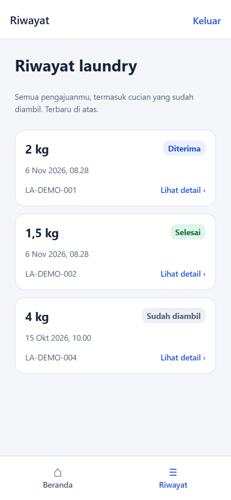
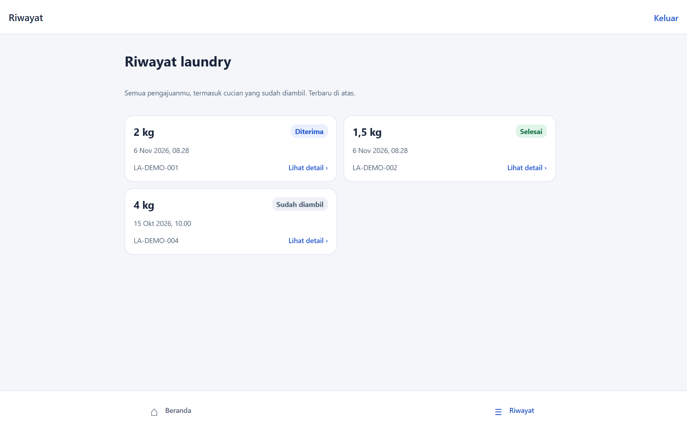
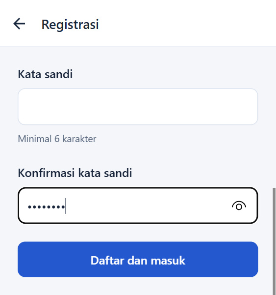
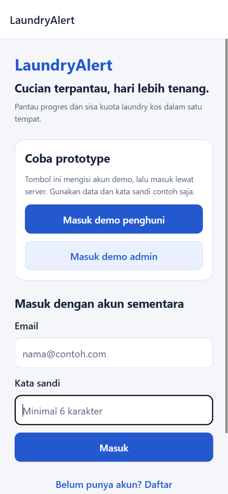
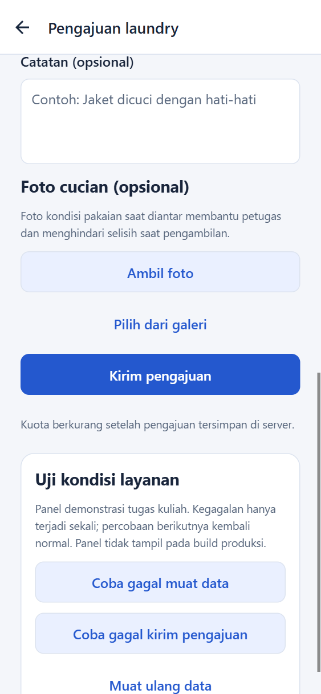
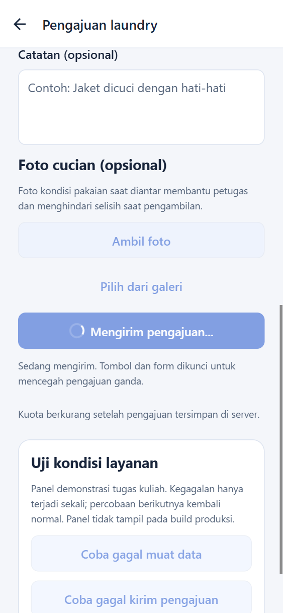
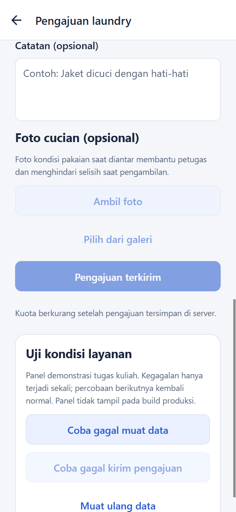

# Kualitas UI — Layout Adaptif, Keyboard-Safe, Aksesibilitas, Feedback Aksi

Empat pekerjaan UI untuk MVP LaundryAlert. Semua screenshot diambil dari aplikasi yang sedang berjalan (`npm run dev`, web di `http://localhost:8081`) memakai Microsoft Edge headless.

## Untuk reviewer (cara me-review saat program di-RUN)

```bash
npm install
npm run dev
```

Buka `http://localhost:8081`, lalu tekan **F12 → ikon perangkat (Ctrl+Shift+M)** untuk mengubah ukuran layar. Akun demo: tombol "Masuk demo penghuni/admin" di layar masuk (lihat [HowToRun.md](../../HowToRun.md)).

| # | Pekerjaan | Cara cek saat RUN | Bukti |
|---|---|---|---|
| 01 | Layout adaptif | Masuk demo penghuni → tab **Riwayat**. Ubah lebar jendela: <768 px = 1 kolom, ≥768 px = 2 kolom dan konten terpusat (maks 880 px) | screenshot 01 (2 gambar) |
| 02 | Keyboard-safe UI | Buka **Daftar**, perkecil tinggi viewport (±400 px, meniru keyboard layar), ketuk kolom paling bawah: kolom tetap terlihat. Tekan Enter: fokus pindah ke kolom berikutnya | screenshot 02 |
| 03 | Aksesibilitas dasar | Tekan **Tab** di layar masuk: fokus berpindah berurutan dengan indikator jelas. Cek pohon aksesibilitas di DevTools → Accessibility | screenshot 03 + [accessibility-tree.txt](accessibility-tree.txt) |
| 04 | Feedback aksi | **+ Ajukan laundry** → Kirim tanpa berat (pesan error) → isi `1` → Kirim (tombol berubah "Mengirim pengajuan...", form terkunci) → "Pengajuan terkirim" | screenshot 04 (3 gambar) |

## 01 — Layout adaptif

Komponen `Screen` dan `CardList` di [`Screen.tsx`](../../src/shared/components/Screen.tsx): konten dibatasi lebar 880 dan dipusatkan, padding menyesuaikan lebar (16 / 24 / 32), dan daftar kartu menjadi 2 kolom pada lebar ≥ 768. Orientasi tidak lagi dikunci (`app.json`).

| Layar kecil (375 px) | Layar besar (1280 px) |
|---|---|
|  |  |

Riwayat: 1 kolom di HP, 2 kolom di layar lebar. Pola yang sama dipakai di Beranda dan antrean admin.

## 02 — Keyboard-safe UI

[`Screen.tsx`](../../src/shared/components/Screen.tsx) membungkus semua layar dengan `KeyboardAvoidingView` (offset tinggi header) dan `ScrollView` (`keyboardShouldPersistTaps="handled"`, keyboard menutup saat scroll). Form Masuk dan Daftar memakai `returnKeyType` + `onSubmitEditing`, jadi Enter pindah ke kolom berikutnya dan di kolom terakhir Masuk langsung mengirim.



Viewport dipendekkan menjadi 375×400 untuk meniru ruang yang tersisa saat keyboard aktif. Kelima kolom Daftar tetap terlihat saat difokuskan (diukur: `top ≥ 0` dan `bottom ≤ tinggi viewport` untuk setiap kolom). Urutan Enter terverifikasi: Nama lengkap → Email → Nomor kamar → Kata sandi → Konfirmasi kata sandi.

## 03 — Aksesibilitas dasar

- Semua tombol: `accessibilityRole="button"`, label, dan state `disabled`/`busy`. Tombol minimal 48 px, kolom input minimal 50 px.
- Setiap input punya `accessibilityLabel`, hint dibacakan lewat `accessibilityHint`; skala font dibatasi 1,6× agar tata letak tidak pecah.
- Pesan error memakai `role="alert"`, status berhasil dan proses memakai `accessibilityLiveRegion="polite"`, gambar punya label, pilihan status admin memakai radio group.



Tab ke-4 jatuh pada kolom **Kata sandi** dengan indikator fokus jelas. Pohon aksesibilitas layar Masuk ([accessibility-tree.txt](accessibility-tree.txt)) menampilkan setiap tombol dan kolom dengan nama yang bermakna.

## 04 — Feedback aksi

Setiap aksi memberi respons terlihat; pengguna tidak dibiarkan menebak:

| Kondisi | Tampilan |
|---|---|
| Validasi gagal | Pesan error merah di atas tombol |
| Sedang memproses | Tombol berubah jadi spinner + "Mengirim pengajuan...", form terkunci, keterangan "Sedang mengirim..." |
| Berhasil | Judul sukses, tombol menjadi "Pengajuan terkirim" |

| 04a Validasi | 04b Memproses | 04c Berhasil |
|---|---|---|
|  |  |  |

Gambar 04b diambil dengan latensi jaringan 2,5 detik yang diemulasikan supaya keadaan "memproses" sempat terlihat.
